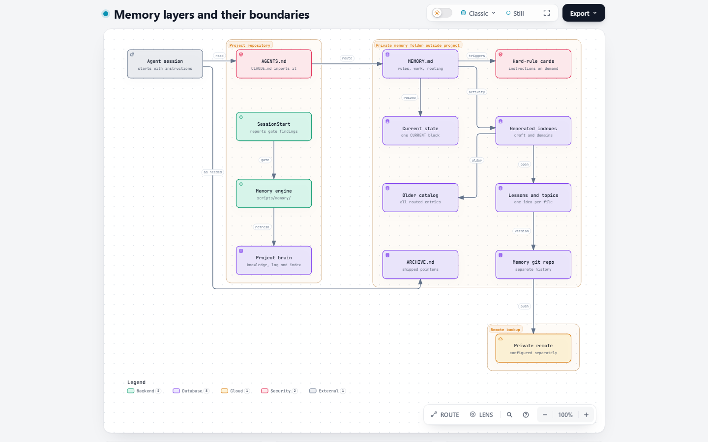
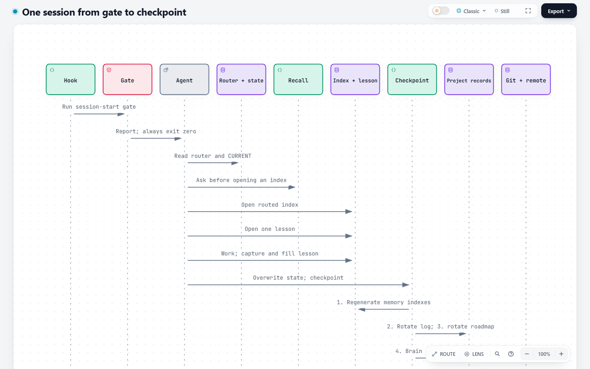
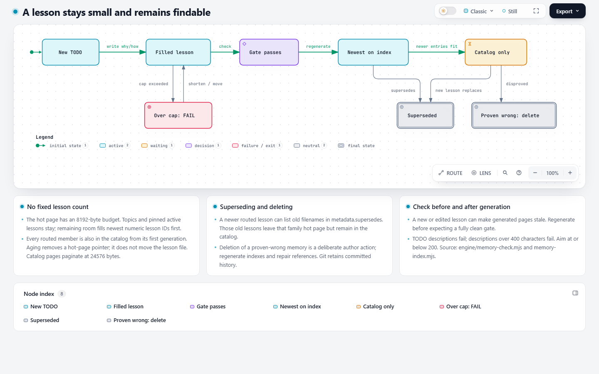
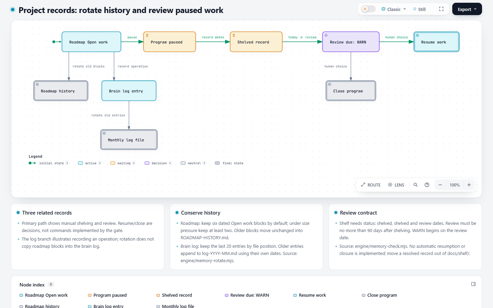
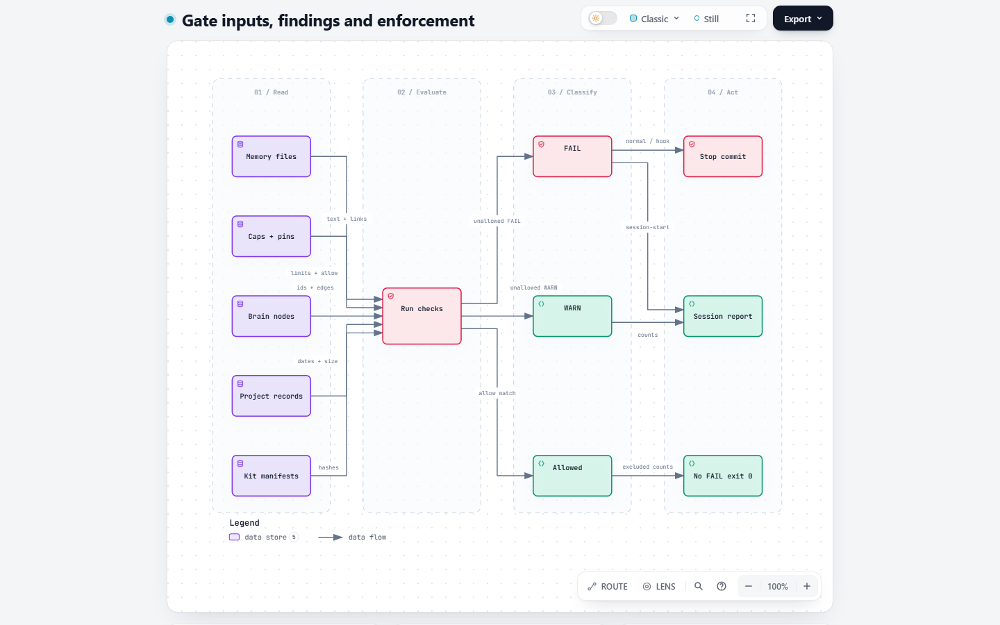
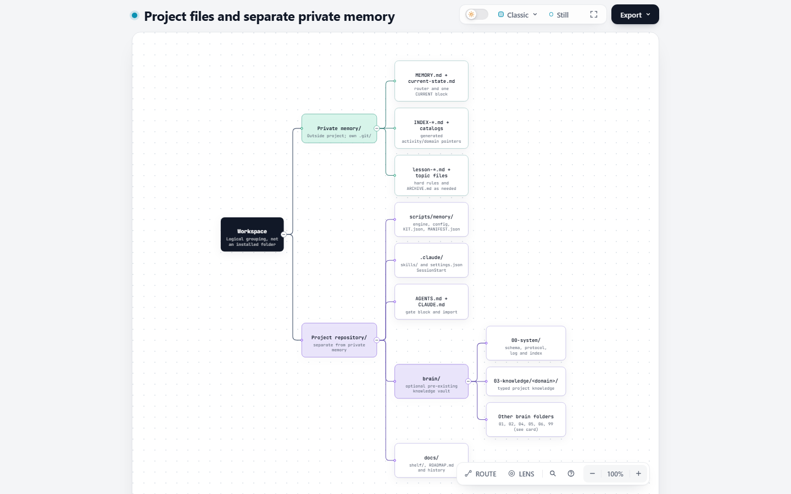

# How memory works

## 1. What this is

The kit keeps agent instructions and lessons in Markdown. A [router](GLOSSARY.md#the-ladder-memory-layers) leads to state, indexes and notes. Project facts live in the project's knowledge folder.

**State is overwritten, facts are moved, history is git.**

## 2. The picture

<picture>
  <source media="(prefers-color-scheme: dark)" srcset="diagrams/png/memory-architecture.dark.png">
  
</picture>

[Interactive diagram](diagrams/README.md) · [Archify source](diagrams/memory-architecture.json)

Start with instructions and the router, then read only the files their triggers require. The table uses the defaults in [memory.config.json](../engine/memory.config.json); KiB means 1024 bytes, and WARN/FAIL size limits trigger when exceeded.

| Layer | File or folder | Loaded when | Default size or structure limit |
| --- | --- | --- | --- |
| Instructions | `AGENTS.md`; `CLAUDE.md` imports it in a fresh install | Agent startup | AGENTS WARN above 16 KiB; no configured FAIL size |
| Start hook | `.claude/settings.json` | SessionStart in the supported agent | No content cap; reports gate findings |
| Router | `MEMORY.md` | Session routing and hard-rule triggers | WARN 12 KiB; FAIL 16 KiB; line FAIL above 600 characters; line count WARN above 150 / FAIL above 200 |
| Hard rules | Individual rule cards in memory | When their router trigger applies | WARN 2 KiB; FAIL 4 KiB |
| Current state | `current-state.md` | Resume and handoff | WARN 4 KiB; FAIL 8 KiB; at most one CURRENT/RESUME heading |
| Generated indexes | `INDEX-craft-<activity>.md`, `INDEX-<domain>.md` | After recall, when routed | 8 KiB hot-page budget; topics and pins may exceed it with WARN |
| Catalog pages | `INDEX-<family>-all.md`, then `-all-2.md`, etc. | Older or broader lookup | 24 KiB per generated page; line WARN 300 / FAIL 450 characters |
| Lessons and topics | `lesson-*.md`, topic files | Relevant individual result | Topic WARN 8 KiB / FAIL 20 KiB; description WARN 200 / FAIL 400 characters |
| Archive | `ARCHIVE.md` | Explicit historical pointer lookup | Line FAIL above 300 characters; no configured total-byte cap |
| Brain | `brain/00-system/`, domain knowledge | Follow a relevant pointer or query | Compact index max 12 KiB; log WARN 50 KiB / FAIL 100 KiB |
| Engine | `scripts/memory/` | Gate, recall, capture and checkpoint commands | Config supplies limits; no source-file size cap |
| History | Memory folder's `.git/` and private remote | Checkpoint or recovery | Ahead WARN at 1 commit / FAIL at 10; remote configured separately |

The [gate](GLOSSARY.md#the-gate-and-its-findings) permits zero state headings; the writing routine requires exactly one current block. Brain node length checks are disabled by default; if enabled, they warn above 350 body words or 200 summary characters. Hand-written indexes use per-file pins instead of the generated hot-page budget: ratcheting sets the smaller of the old pin and current size plus 1024 bytes, with a warning below 400 bytes of remaining room. [About the limits](LIMITS.md) explains what each limit protects and where each number came from.

The fresh installer creates a sessions route, not a complete set of activity/domain families or a complete brain. Add routes and cards when needed. See [the routine](../skills/memory-ladder/SKILL.md) and [installer](../scripts/install.mjs).

## 3. A session, step by step

<picture>
  <source media="(prefers-color-scheme: dark)" srcset="diagrams/png/session-sequence.dark.png">
  
</picture>

[Interactive diagram](diagrams/README.md) · [Archify source](diagrams/session-sequence.json)

1. Run the gate; read the router's applicable hard rules and current state.
2. Ask recall before opening an index. Open the activity index required by the router, then the relevant lesson.
3. Do the work and capture a lesson when something reusable is learned. Fill its description, why and how-to-apply body.
4. Overwrite the CURRENT block with the task, next action and handoff.
5. Run checkpoint: regenerate memory indexes, rotate the brain log, rotate roadmap blocks, refresh the brain index, refresh the roadmap overview, gate, commit memory, then push. Optional records are skipped when absent; project changes are committed separately.

That order comes from [memory-checkpoint.mjs](../engine/memory-checkpoint.mjs). `--no-push` still commits; `--dry-run` does neither. A failed push leaves the commit and exits 2.

These synthetic excerpts use engine 3.2.12 and `~/memory`; timings vary. `--no-git` skips Git health and committed-age checks.

Install output (excerpt; paths abbreviated):

```text
memory: ~/memory (--memory-dir)
WARN repo.remote . memory repo has no remote
memory-check 3.2.12 [all]: 0 FAIL, 1 WARN, 0 allowed, 4 files, 0 inbox notes, 1 KB, 159 ms
memory gate hook installed; checks before saving a Git commit: ~/memory/.git/hooks/pre-commit
Self-test: node --test scripts/memory/memory.selftest.mjs
```

Initial gate:

```sh
node scripts/memory/memory-check.mjs --no-git --memory-dir ~/memory
```

```text
memory: ~/memory (--memory-dir)
WARN repo.git-skipped . git health and committed-age checks skipped (--no-git)
memory-check 3.2.12 [all]: 0 FAIL, 1 WARN, 0 allowed, 4 files, 0 inbox notes, 1 KB, 29 ms
```

Startup of the same fixture:

```sh
node scripts/memory/memory-check.mjs --no-git --session-start --memory-dir ~/memory
```

```text
memory gate: ok (0 allowed, 1 warn, engine 3.2.12)
```

The warning reports the skipped Git checks. “ok” means no unallowed FAIL, not zero warnings.

Two different families were added to the router, then these commands created the lessons:

```sh
node scripts/memory/memory-lesson.mjs new --kind mistake --route craft-shell "Quote shell arguments" --memory-dir ~/memory
node scripts/memory/memory-lesson.mjs new --kind mistake --route craft-testing "Keep test proof" --memory-dir ~/memory
node scripts/memory/memory-index.mjs --write --memory-dir ~/memory
```

After filling their TODO descriptions and bodies, index generation reported:

```text
memory index: 6 pages
```

The shell index contains this generated row:

```md
- [#001](lesson-001-quote-shell-arguments.md) — Pass shell arguments separately so spaces stay inside one argument.
```

Recall found the lesson without loading every note:

```sh
node scripts/memory/memory-recall.mjs "How should I pass shell arguments with spaces?" --memory-dir ~/memory
```

```text
1. 6.5  lesson-001-quote-shell-arguments.md - Pass shell arguments separately so spaces stay inside one argument.
```

The state block was overwritten, not appended:

```md
## CURRENT

The example now has two lessons and working recall. Next: review the saved test proof. No external action is pending.
```

Checkpoint preview:

```sh
node scripts/memory/memory-checkpoint.mjs --dry-run --no-push --memory-dir ~/memory
```

```text
memory-index: dry-run
rotate-log: dry-run
rotate-roadmap: dry-run
brain-index: dry-run
roadmap-overview: dry-run
gate: dry-run
commit: dry-run
push: skipped
```

This demonstrates the announced order, not completed rotation, commit or push.

## 4. How memory stays small

<picture>
  <source media="(prefers-color-scheme: dark)" srcset="diagrams/png/lesson-lifecycle.dark.png">
  
</picture>

[Interactive diagram](diagrams/README.md) · [Archify source](diagrams/lesson-lifecycle.json)

Several lessons use a filled Markdown batch outside memory. When a rule recurs, record a dated cause with `repeat`, then decide enforcement with `enforce`; the full commands and thresholds are below.

A lesson is one file. Capture allocates the next numeric lesson identity and requires known router families; generated membership comes from `metadata.route`. Fill TODO before checking. A changed lesson also makes indexes stale until regeneration, so the practical loop is **fill → regenerate → gate**.

The hot index has a byte budget, not a fixed lesson count. Topics and pinned active lessons stay, and remaining room fills with active lessons in descending numeric identity order. All routed entries already appear in the catalog, including hot entries; aging removes the hot-page pointer, not the lesson file. Catalogs paginate at 24 KiB. A `supersedes` list of old filenames removes those lessons from that family's hot page while preserving their catalog entries. Delete a memory proven wrong, repair references and regenerate; its committed history remains in git. See [index generation](../engine/memory-index.mjs) and [capture](../engine/memory-lesson.mjs).

Keep the router as triggers and pointers. Move shipped active-work pointers to `ARCHIVE.md`, which is not loaded by default; it is a ledger, not a second journal. Move explanation into linked detail and project facts into the brain. Write and verify a destination before shortening the original pointer; never raise caps, pins or allow ceilings just to pass.

<picture>
  <source media="(prefers-color-scheme: dark)" srcset="diagrams/png/records-lifecycle.dark.png">
  
</picture>

[Interactive diagram](diagrams/README.md) · [Archify source](diagrams/records-lifecycle.json)

Roadmap rotation retains six dated Open work blocks by default, or at least two under size pressure, and copies older blocks unchanged to `docs/ROADMAP-HISTORY.md`. Blocks start with dated `**YYYY-MM-DD ...` lines; oldest dates move first, with configured order breaking ties. The default roadmap size thresholds are WARN 60 KiB and FAIL 80 KiB. Brain-log rotation keeps the last 20 entries by file position and appends older entries to `log-YYYY-MM.md` using each entry's own date. See [memory-rotate.mjs](../engine/memory-rotate.mjs).

A paused program belongs in `docs/shelf/<name>.md` with `status: shelved`, `shelved` and `review` dates. Review must be no more than 90 days after shelving; the gate warns on or after the review date. Resuming or closing is a human/agent decision, not an automatic gate transition; move a resolved record out of the shelf while preserving its history. The demo produced:

```text
WARN shelf.review-due docs/shelf/example-paused-task.md review due 2020-02-01 (shelved 2020-01-01)
```

Measurement follows router, index and catalog links, includes every navigation page in the path byte count, and reports `direct`, `index` or `catalog` for the finding hop.

## 5. The gate

<picture>
  <source media="(prefers-color-scheme: dark)" srcset="diagrams/png/gate-dataflow.dark.png">
  
</picture>

[Interactive diagram](diagrams/README.md) · [Archify source](diagrams/gate-dataflow.json)

The [gate implementation](../engine/memory-check.mjs) reads content, links, caps and pins, git health, project records and installed kit hashes. Normal checks exit 1 on an unallowed FAIL. SessionStart reports and always exits 0. Memory pre-commit checks a staged snapshot with `--hook --scope memory`; a FAIL or snapshot-extraction error blocks that commit. It does not enforce all project-record checks.

| Finding | What to fix |
| --- | --- |
| `router.lines` | Keep the router at most 200 lines; warning above 150. |
| `chars.*` | Preview `memory-chars.mjs repair`, allow deliberate examples, then `--write`; fix residues by hand. |
| `lesson.enforce`, `lesson.enforced`, `lesson.repeats` | Record repeats and a valid decision; see the repeat flow below. |
| `lesson.unfilled-body` | Fill an empty exact prompt section. |
| `lesson.kind`, `lesson.kind-missing`, `lesson.trigger` | Classify lessons and add a cue before repeating the mistake. |
| `date.future`, `enforce.rules`, `config.caps` | Repair dates, rules or invalid configuration. |
| `split.chain`, `topic.line` | Repair back links and long paragraphs; hand-review reported numbering/order/list problems. |
| `lesson.unfilled` | Replace the TODO description and fill why/how content. |
| `desc.length`, `topic.size`, `router.size`, `hardrule.size` | Keep the summary short; move detail to the appropriate deeper file. |
| `state.headings` | Replace old state with one current block. |
| `route.missing`, `route.unknown` | Use a family linked in the router. |
| `index.stale` | Run `memory-index.mjs --write` after editing lessons/routes. |
| `index.unreachable` | Restore a router-to-index-to-catalog path to a routed or indexed lesson/topic. |
| `config.upgrades` | Repair malformed deferred-upgrade ledger data. |
| `index.pin` | Move detail down; do not raise an existing pin. |
| `link.dead`, `brain.pointer` | Restore the target or update the pointer to an existing file. |
| `shelf.frontmatter`, `shelf.review-due` | Supply valid shelf metadata, then review due work. |
| `repo.remote`, `repo.uncommitted` | In normal use, configure the private backup and checkpoint the intended files. |
| `kit.version`, `kit.manifest` | Inspect engine drift and use the upgrade procedure; do not relabel edited code. |
| `secret` | Remove the secret from scanned content; this finding cannot be allowed. |

Allowed findings remain visible in JSON but are excluded from FAIL/WARN counts. Allow entries need a reason and added date, and can carry a ceiling; they do not make content correct. Secrets, configuration errors and frontmatter parse FAIL cannot be allowed.

Running the normal gate with `--no-git` in the demo after replacing the first lesson description with 401 characters and regenerating produced:

```text
memory: ~/memory (--memory-dir)
FAIL desc.length lesson-001-quote-shell-arguments.md description is 401 chars (max 400)
WARN repo.git-skipped . git health and committed-age checks skipped (--no-git)
memory-check 3.2.12 [all]: 1 FAIL, 1 WARN, 0 allowed, 10 files, 0 inbox notes, 3 KB, 42 ms
```

The normal command exited 1; the same failure under `--session-start` exited 0. Restoring its concise description and regenerating produced:

```text
memory: ~/memory (--memory-dir)
WARN repo.git-skipped . git health and committed-age checks skipped (--no-git)
memory-check 3.2.12 [all]: 0 FAIL, 1 WARN, 0 allowed, 10 files, 0 inbox notes, 2 KB, 47 ms
```

The cap failure is clean again. The intentional skipped-Git warning remains, and the shelf example adds a second warning.

## 6. The brain

The [brain](GLOSSARY.md#the-brain-project-knowledge-vault) is the project's typed Markdown knowledge vault: it holds facts, decisions and other knowledge that should travel with the project. Memory retains the agent-side instruction and a pointer into that vault, instead of copying the whole project record.

These types and paths are examples; the kit does not install a knowledge schema. Node types tell you what a record means: pillar, project, decision and playbook; concept, question, hypothesis, pattern and fact; task and event; source, bookmark, reference and contact; note and custom. Each node has a stable identity, type and routing metadata, so read its summary and links before its body; confidence metadata belongs to claim types (fact, hypothesis, pattern and decision).

Domains group knowledge by subject under `brain/03-knowledge/<domain>/`, and a node's `domain` mirrors that placement. A domain is not a memory activity family: a domain says what the knowledge concerns, while a craft route says when the agent should consult it.

Project facts live in the project's own knowledge folder, under that folder's own rules. The gate validates basic node integrity, not every project-specific rule. A memory pointer looks like:

```yaml
brain: brain/03-knowledge/example/fct-example-rule.md
```

That made-up target must exist before the pointer is used. The gate rejects missing, absolute or escaping targets; see [brain.pointer checks](../engine/memory-check.mjs).

## 7. Where things live

<picture>
  <source media="(prefers-color-scheme: dark)" srcset="diagrams/png/where-things-live.dark.png">
  
</picture>

[Interactive diagram](diagrams/README.md) · [Archify source](diagrams/where-things-live.json)

The brain convention is `00-system`, `01-pillars`, `02-projects`, `03-knowledge/<domain>`, `04-playbooks`, `05-sources`, `06-people` and `99-inbox`. The tree groups some folders into a card to keep the overview readable; it shows a project using a brain, not what a blank install automatically creates. Custom memory locations are remembered in ignored `scripts/memory/KIT.local.json`; `KIT.json` is the installation receipt and contains no machine path.

The installed glossary lives at `scripts/memory/GLOSSARY.md`. Read-only fleet status (`memory-fleet.mjs --root <projects>`) reports kit versions, memory size, commit activity and gate counts across projects; excluded folders are represented only by a count.

## 8. Converting old memory and upgrading the kit

Use [CONVERT.md](CONVERT.md) for old journals, oversized routers or combined lesson files. Work in a separate copy, preserve destinations before shortening sources, run token and block conservation proofs, and check meaning and recall before adoption; token presence alone does not prove equivalent instructions.

Use [UPGRADE.md](UPGRADE.md) when replacing the installed engine. Preview with the upgrade check, review local edits, keep the generated backup and run the gate afterward; the upgrade preserves project-owned configuration and rolls back on a new FAIL.

The deferred-upgrade ledger (`upgrades.json`) records deliberately postponed ideas; measurement and fleet reports show whether their evidence-based triggers are DORMANT, FIRED, NEVER or UNKNOWN.

## 9. Terms

Every term is defined in [GLOSSARY.md](GLOSSARY.md).

## 3.2.7 capture and enforcement

A lesson records one reusable rule: a `mistake` corrects a failure, a `practice` records a successful method,
and an `observation` records something to verify before reuse. Choose the kind explicitly. Keep a short
`metadata.trigger` such as "before retrying". Where a mistake is visible determines enforcement: a command
gets a hook, a file gets a check, and judgment gets a hard-rule card or a reasoned lesson-only decision.

```sh
node scripts/memory/memory-lesson.mjs new --kind mistake --route craft-sessions --trigger "before retrying" "Check before retrying"
node scripts/memory/memory-index.mjs --write
node scripts/memory/memory-check.mjs
node scripts/memory/memory-lesson.mjs batch <scratch>/lessons.md --dry-run
node scripts/memory/memory-lesson.mjs batch <scratch>/lessons.md
node scripts/memory/memory-lesson.mjs repeat 1 "slip: retried without checking"
node scripts/memory/memory-lesson.mjs enforce 1 "check <check-id-or-repo-file>"
node scripts/memory/memory-lesson.mjs enforce 1 "hook <repo-file>"
node scripts/memory/memory-lesson.mjs enforce 1 "hard-rule <memory-file>"
node scripts/memory/memory-lesson.mjs enforce 1 "lesson-only <reason of at least ten characters>"
node scripts/memory/memory-lesson.mjs repeat --from-legacy
node scripts/memory/memory-lesson.mjs repeat --from-legacy --write
node scripts/memory/memory-lesson.mjs classify <scratch>/kinds.json
node scripts/memory/memory-lesson.mjs classify <scratch>/kinds.json --write
```

For one lesson use `new`, fill the TODO description and body, regenerate, then gate. For several, use a Markdown
batch outside memory: each `## Title` has `kind: mistake|practice|observation`, `route: family`, a useful
`description:`, a blank line, and the complete body. Use `###` for body headings. A `repeat-of: 1` section instead
has only `cause:`, `description:` and optional `date:`, with no body; it records a repeat without allocating a number.
The four causes are `slip`, `not-recalled`, `rule-wrong` and `new-case`. Use a new lesson with `supersedes` when the
rule changes; never append a second rule. Classification reads `{"version":1,"kinds":{"lesson-001-example.md":"mistake"}}`.

Record repeats with the command, never extra prose. `lesson.enforce` WARNs at two and FAILs at four repeats without
a decision. A present but invalid `enforced` value (including a renamed or deleted hook file) counts as no decision
and also produces `lesson.enforced` WARN. Repair the decision. After a valid decision, one strictly later UTC-date
repeat WARNs and four FAIL; same-day repeats do not reopen it. `caps.lesson.lessonOnlyReturns: false` makes a valid
lesson-only decision permanent. Otherwise decide again. Add a trigger when `lesson.trigger` warns. Legacy conversion
is dry-run-first and idempotent on `--write`; it keeps the original paragraphs. Never use an allow entry for escalation.

The guard's starter rules ship as `warn`. Test a command saved in a file with
`node scripts/memory/memory-guard.mjs test <scratch>/command.txt`; replay real commands with
`node scripts/memory/memory-guard.mjs replay <scratch>/commands.jsonl`. Only after the rate is below 0.5 percent and
every sampled hit is a real hazard, switch that rule to `deny` in the host-owned `scripts/memory/enforce-rules.json`:
`{"version":1,"rules":[{"id":"piped-gate","action":"deny"}]}`. Kit defaults in `enforce-rules.kit.json` are refreshed on upgrade.
Claude Code receives guard warnings in PreToolUse `additionalContext`; verify that context reaches the model during
rollout. The prompt clock prints local time first, UTC second. Hand-written dates use UTC; `date.future` compares with
the UTC date of now, WARNs one day ahead and FAILs later.

For linked detail, run `node scripts/memory/memory-chains.mjs scan`, then
`node scripts/memory/memory-chains.mjs repair --write`. Parts start with `Part N of`, a Markdown link to the parent, and a period; parents link
parts in number order. Repair inserts missing back links; numbering, gaps and order need review by hand.
`node scripts/memory/memory-chains.mjs lines --write` recuts paragraphs only at sentence ends; hand-cut reported list
items and indented lines. Keep procedures, recipes, fenced blocks, tables, verbatim payloads and one incident's cause
chain whole. Keep everything needed to apply the rule in its file; move explanation whole to linked backgrounds.

When one event teaches several rules, write one lesson per rule and link one shared dated background file
(named `<date>-<slug>-background.md`, not a lesson, with `type: reference`, no route and no parent). Keep each
lesson sufficient to apply its rule. A five-to-twelve-line lesson is guidance, not a gate limit; a unit that cannot
fit the topic FAIL cap belongs whole in linked docs or a brain node. Amended and Confirmed paragraphs remain prose
during legacy conversion; review them rather than manufacturing repeat entries.

## Lesson casebook (3.2.8)

Read `scripts/memory/LESSON-KINDS.md` for K0, T1-T4 and K1-K10 before choosing a kind.
A true near-miss is practice when its title names the deliberate step; harm or an
acted-on verdict is mistake. Tool behaviour under normal use is observation;
our command shape is mistake. Label every row independently; record doubt in confidence.
Use optional `new --case Kn`, batch `case: Kn`, or the classify `cases` map to write
`metadata.kind_case`. `classify --case Kn` lists carriers. Missing/unknown cases
produce `kind.case` WARN only when present; superseded ones get `kind.case-superseded`.
Follow `scripts/memory/LABELLING.md` for two independent labellers: the kind test allows
at most 6 of 40 disagreements, scaled down; person-set labels are takeaways, not a
kind reference. Compare with `classify --score A.json B.json [--json]`.
Settle obvious rows by citing a case; uncertain rows with no similar case go to
a decision table for human review. No automatic bulk relabel or new memory types ship here.
Use separate option values: `--name value`; the shared parser refuses `--name=value`.
Hook/check file enforcement resolves symlinks and junctions and requires the real
file to remain inside the repo. An invalid recorded decision still escalates and
its `lesson.enforce` message ends with `; the recorded decision is invalid: <reason>`.

People set optional `metadata.takeaway`: `fix` (an error and its remedy), `method`
(the best way or next-time action), or `know` (how things work). Models label
`kind` and never set `takeaway` by default. Capture an explicit person-set value with
`new --takeaway fix`, batch `takeaway: fix`, or a classify `takeaways` map. Omitted
values stay untouched. Recall shows it and filters with `--takeaway fix|method|know`.
Invalid present values produce `lesson.takeaway` WARN, never FAIL.
